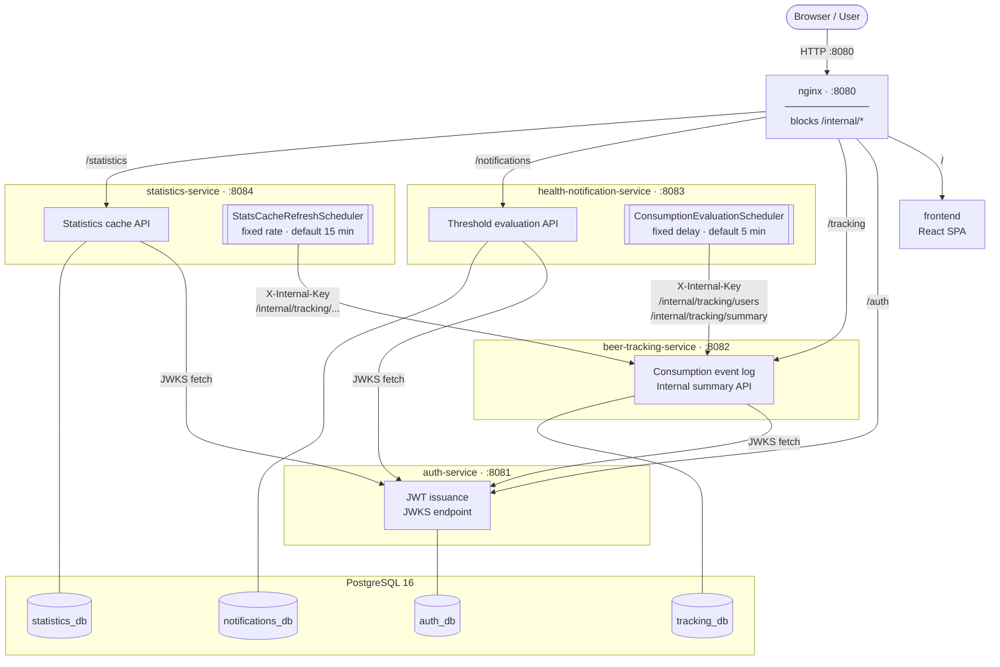

# Beer Tracker

A microservices application for tracking beer consumption with health threshold monitoring and notifications. Users log drinks via a React frontend; backend services record events, evaluate consumption against configurable thresholds, aggregate statistics, and issue JWT-authenticated API calls between services.

## Table of Contents

- [Architecture](#architecture)
- [Configuration Reference](#configuration-reference)
- [Development container](#development-container)
- [Scenario 1 — Podman Compose / Docker Compose](#scenario-1--podman-compose--docker-compose)
- [Scenario 2 — minikube](#scenario-2--minikube)
- [Scenario 3 — Azure AKS](#scenario-3--azure-aks)
- [Troubleshooting](#troubleshooting)

---

## Architecture



> **Scheduled jobs** (double-bar boxes) run as in-process Spring `@Scheduled` tasks inside their service — not as separate containers. `ConsumptionEvaluationScheduler` polls tracking data and evaluates daily/weekly thresholds; `StatsCacheRefreshScheduler` refreshes the aggregated statistics cache. The nginx ingress returns `403` on any `/internal/*` path, so these internal routes are unreachable from the browser.

### Services

| Service | Port | Description | Database |
|---|---|---|---|
| `auth-service` | 8081 | Issues and validates JWTs using RSA-256. Exposes JWKS endpoint for token verification. | `auth_db` |
| `beer-tracking-service` | 8082 | Records beer consumption events. Validates JWTs via JWKS. | `tracking_db` |
| `health-notification-service` | 8083 | Evaluates consumption against daily/weekly thresholds; sends notifications when exceeded. | `notifications_db` |
| `statistics-service` | 8084 | Aggregates consumption data for analysis and reporting. | `statistics_db` |
| `frontend` | 80 | React/Vite SPA served as static files. | — |

All five services sit behind an **nginx reverse proxy** (compose) or a **Kubernetes ingress controller** (minikube/AKS), which routes requests to the correct upstream based on URL path.

### Data layer

A single PostgreSQL 16 instance (compose) or a Bitnami PostgreSQL chart / Azure PostgreSQL Flexible Server (Kubernetes) hosts all four databases. Schema is initialised from `postgres-init/init.sql`.

### RSA key flow

`auth-service` loads an RSA-256 private key at startup and uses it to sign JWTs. The matching public key is published at `/auth/.well-known/jwks.json`. All other services fetch that JWKS endpoint on startup and cache it for token verification. No other service ever sees the private key.

| Scenario | Key delivery mechanism |
|---|---|
| Compose | `secrets/auth-rs256-private-key.pem` bind-mounted read-only into the container |
| minikube | `deploy-minikube.sh` reads `.env` → `kubectl create secret generic beer-tracker-secrets` → pod consumes via `envFrom` |
| Azure AKS | `deploy-azure.sh` reads `AUTH_RSA_KEY_PATH` → `kubectl create secret generic beer-tracker-secrets` → pod consumes via `envFrom` |

---

## Configuration Reference

| Variable | Used by | Description |
|---|---|---|
| `POSTGRES_PASSWORD` | All Spring services, postgres | Password for the `postgres` superuser |
| `INTERNAL_API_KEY` | All Spring services | Shared secret for service-to-service calls |
| `AUTH_PRIVATE_KEY_PATH` | `auth-service` | Filesystem path to RSA-256 private key PEM |
| `JWKS_URI` | `beer-tracking-service`, `health-notification-service`, `statistics-service` | URL of the JWKS endpoint on `auth-service` |
| `BEER_TRACKING_INTERNAL_URL` | `health-notification-service`, `statistics-service` | Base URL of `beer-tracking-service` for internal calls |
| `THRESHOLD_DAILY_DRINKS` | `health-notification-service` | Daily drink count that triggers a notification |
| `THRESHOLD_WEEKLY_DRINKS` | `health-notification-service` | Weekly drink count that triggers a notification |
| `VITE_API_BASE_URL` | `frontend` (build-time) | Base URL the browser uses to reach the API |

Copy `.env.example` to `.env` and fill in values before running any scenario. See `secrets/README.md` for key generation instructions.

---

## Development container

A [development container](.devcontainer/README.md) with the full toolchain (JDK, Maven, Node, Podman Compose, minikube, Terraform, Azure CLI) lets you run the scenarios below without installing those tools yourself. It needs a **rootful** Podman engine on the host and two VS Code settings; read the [guide](.devcontainer/README.md) before opening it. It is tested on Windows 11 with Podman Desktop; native Linux and macOS are not yet tested.

---

## Scenario 1 — Podman Compose / Docker Compose

Runs the full stack on your laptop. nginx listens on `localhost:8080`.

### Prerequisites

- **Podman ≥ 4** + **Podman Compose ≥ 1.0**, **or** Docker + Docker Compose v2 (`docker compose` subcommand)
- `openssl` available on `$PATH`

### Setup

1. Generate the RSA private key:

   ```bash
   openssl genrsa -out secrets/auth-rs256-private-key.pem 2048
   ```

2. Create your local environment file:

   ```bash
   cp .env.example .env
   # Edit .env and set POSTGRES_PASSWORD and INTERNAL_API_KEY
   ```

3. Start the stack:

   ```bash
   # Podman
   podman compose up -d

   # Docker
   docker compose up -d
   ```

### Verification

```bash
curl http://localhost:8080
```

The frontend HTML should be returned. Individual service health endpoints are available on their direct ports (e.g. `curl http://localhost:8081/actuator/health`).

### Troubleshooting

| Symptom | Resolution |
|---|---|
| `address already in use :8080` | Find the conflicting process: `lsof -i :8080`. Change the host port in `docker-compose.yml` if needed. |
| `auth-service` exits at startup | Verify `secrets/auth-rs256-private-key.pem` exists and is readable. Re-run step 1. |
| `postgres` health check fails | First-time volume init can be slow. Run `podman compose logs postgres` and wait for `database system is ready`. |
| Services fail with `Connection refused` to postgres | Ensure the `depends_on` health check is satisfied. Check that `POSTGRES_PASSWORD` in `.env` matches what postgres was initialised with. |

---

## Scenario 2 — minikube

Deploys the Helm umbrella chart to a local minikube cluster. Useful for validating chart changes before pushing to Azure.

### Prerequisites

- **minikube ≥ 1.32**
- **kubectl**
- **helm ≥ 3.10**
- `.env` file created from `.env.example` (same file as Scenario 1)

### Setup

1. Start minikube:

   ```bash
   minikube start
   ```
   When running in a devcontainer use instead:
   ```bash
   devcontainer-minikube-start
   ``` 
   see also [development container](.devcontainer/README.md) documentation


2. Create `.env` from `.env.example` if you have not already:

   ```bash
   cp .env.example .env
   # Edit .env: set POSTGRES_PASSWORD, INTERNAL_API_KEY, AUTH_RSA_KEY_PATH
   ```

3. Deploy:

   ```bash
   ./scripts/deploy-minikube.sh
   ```

   The script reads `.env`, creates the `beer-tracker` namespace, creates the `beer-tracker-secrets` Secret (keys `auth-rs256-private-key`, `SPRING_DATASOURCE_PASSWORD`, `INTERNAL_API_KEY`, the same as on Azure) from `.env`, builds images into the minikube Docker daemon, and runs `helm upgrade --install`.

4. Expose the ingress (if needed):

   ```bash
   minikube addons enable ingress
   echo "$(minikube ip)  beer-tracker.local" | sudo tee -a /etc/hosts
   ```

### One-time database initialisation

After the first deploy, run `postgres-init/init.sql` against the in-cluster PostgreSQL pod:

```bash
# Wait for PostgreSQL pod to be ready
kubectl wait --for=condition=ready pod -l app.kubernetes.io/name=postgresql \
  -n beer-tracker --timeout=120s

# Copy the init SQL into the PostgreSQL pod and run it
kubectl cp postgres-init/init.sql beer-tracker/$(kubectl get pod \
  -l app.kubernetes.io/name=postgresql -n beer-tracker \
  -o jsonpath='{.items[0].metadata.name}'):/tmp/init.sql \
  -n beer-tracker

kubectl exec -n beer-tracker \
  $(kubectl get pod -l app.kubernetes.io/name=postgresql \
    -n beer-tracker -o jsonpath='{.items[0].metadata.name}') -- \
  psql -U postgres -f /tmp/init.sql
```

### Verification

```bash
kubectl get pods -n beer-tracker
```

All pods should reach `Running` status.

### Accessing the application

The ingress controller is reachable at `$(minikube ip)` on port 80. On **Linux or WSL2**, that IP is only accessible within the VM/subsystem. Forward the ingress controller port to your local machine instead:

```bash
kubectl port-forward -n ingress-nginx \
  service/ingress-nginx-controller 8080:80
```

Leave this running, then open `http://localhost:8080` in your browser. All ingress routes are available through the single forwarded port:

| Path | Service |
|---|---|
| `/` | Frontend |
| `/auth/...` | Auth service |
| `/tracking/...` | Beer tracking |
| `/notifications/...` | Health notifications |
| `/statistics/...` | Statistics |

Stop the forward with `Ctrl-C`.

### Troubleshooting

| Symptom | Resolution |
|---|---|
| `ImagePullBackOff` | Images must be built inside the minikube Docker daemon. Run `eval $(minikube docker-env)` then rebuild. `values-minikube.yaml` sets `imagePullPolicy: Never`. |
| `Secret not found` | `deploy-minikube.sh` creates `beer-tracker-secrets`. Re-run the script, or create it manually with `kubectl create secret generic beer-tracker-secrets` using the keys `auth-rs256-private-key`, `SPRING_DATASOURCE_PASSWORD` and `INTERNAL_API_KEY`. Pods in `CreateContainerConfigError` usually mean this Secret is missing or has different key names. |
| Ingress returns 404 / not routing | Confirm `minikube addons enable ingress` completed. Check ingress class is `nginx` (set in `values-minikube.yaml`). |
| Pods stuck in `Pending` | Check node resources: `kubectl describe node minikube`. Increase minikube memory: `minikube start --memory=4096`. |

---

## Scenario 3 — Azure AKS

Production-grade deployment on Azure Kubernetes Service. Uses Azure Container Registry for images, a Kubernetes Secret for application secrets, and Azure Application Gateway as the ingress.

Infrastructure is defined in `infra/terraform/` via two reusable modules (`network`, `aks`) and per-environment stage roots under `infra/terraform/stages/`. Each stage is self-contained — `terraform init` and `terraform apply` require no flags or environment variables. See [infra/terraform/README.md](infra/terraform/README.md) for full details.

Application secrets are stored in a Kubernetes Secret (`beer-tracker-secrets`) in the `beer-tracker` namespace. `deploy-azure.sh` creates or updates this secret automatically on every run.

### Authentication

All commands in this scenario require an active Azure CLI session.

**Log in** (opens a browser):

```bash
az login
```

**Verify the correct subscription is active:**

```bash
az account show --query "{name:name, id:id}" -o table
```

If a different subscription is shown, switch before running anything else:

```bash
az account set --subscription <subscription-id-or-name>
```

**Required permissions:** The signed-in identity needs **Owner**, or **Contributor + User Access Administrator**, on the subscription. Contributor alone is not sufficient — the Terraform configuration creates role assignments (AGIC roles, ACR pull for the kubelet identity) that require `Microsoft.Authorization/roleAssignments/write`.

**Terraform** authenticates via the active Azure CLI session automatically. No service principal or environment variables are needed for local use.

### Prerequisites

- **Terraform ≥ 1.9**
- **Azure CLI (`az`) ≥ 2.60** logged in with Owner or Contributor + User Access Administrator on the subscription
- **Docker or Podman** (for building and pushing images to ACR; the deploy script uses `--expose-token` and is compatible with both)
- **kubectl**
- **kubelogin** — required because the AKS cluster has local accounts disabled and uses Entra ID (Azure AD) authentication, so `kubectl` calls the `kubelogin` plugin to obtain a token. `az aks install-cli` installs both `kubectl` and `kubelogin` and can pin their versions (`--client-version`, `--kubelogin-version`); other options are in the [kubelogin install guide](https://azure.github.io/kubelogin/install.html) (accessed 2026-10-08).
- **helm ≥ 3.10**
- `openssl` available on `$PATH`
- **AKS cluster access**: the cluster uses Entra ID with Azure RBAC and has local accounts disabled, so `kubectl` also needs the `Azure Kubernetes Service RBAC Cluster Admin` role on the cluster (Owner or Contributor on the subscription is not enough). Terraform grants it to the Entra ID object IDs listed in `local.aks_cluster_admin_object_ids` in `infra/terraform/stages/dev/main.tf` (add yours; find it with `az ad signed-in-user show --query id -o tsv`); with an empty list no assignment is created.

  > Checked 2026-10-08: after `terraform apply` with an object ID in the list, `kubectl` worked against the cluster without a manual role assignment (reported by the project owner; the deploy scripts were not re-run for this check).

### Setup

#### Phase 1 — Provision infrastructure with Terraform

1. Generate the RSA private key if you have not already:

   ```bash
   openssl genrsa -out secrets/auth-rs256-private-key.pem 2048
   ```

2. Create the resource group and Log Analytics workspace. Terraform reads these but does not create them:

   ```bash
   az group create \
     --name <deployment-resource-group-name> \
     --location germanywestcentral

   az monitor log-analytics workspace create \
     --resource-group <deployment-resource-group-name> \
     --workspace-name <log-analytics-workspace-name> \
     --location germanywestcentral
   ```

3. Bootstrap the remote state storage account (one-time):

   ```bash
   scripts/bootstrap-tf-state.sh \
     --resource-group  <terraform-resource-group-name> \
     --storage-account <globally-unique-name> \
     --container       tfstate \
     --location        germanywestcentral
   ```

4. Fill in the two placeholder values in the stage files before first init:
   - `infra/terraform/stages/dev/main.tf` → set `subscription_id` to the dev subscription ID
   - `infra/terraform/stages/dev/backend.tf` → set `storage_account_name` to the name chosen in step 3

5. Initialise and apply Terraform (no flags or environment variables required):

   ```bash
   cd infra/terraform/stages/dev
   terraform init
   terraform plan -out=tfplan
   terraform apply tfplan
   ```

6. Verify `kubectl` is configured (optional — `deploy-azure.sh` does this automatically):

   ```bash
   cd infra/terraform/stages/dev
   AKS_CLUSTER_NAME=$(terraform output -raw aks_cluster_name)

   az aks get-credentials \
     --resource-group <deployment-resource-group-name> \
     --name "$AKS_CLUSTER_NAME" \
     --overwrite-existing
   ```

   `kubectl` access to this cluster requires `kubelogin` on your `PATH` (see Prerequisites); without it, `kubectl` commands fail when they try to obtain a token.

   Skip this step if you are proceeding directly to Phase 2; the deployment script configures credentials as part of its run.

#### Phase 2 — Build, push, and deploy the application

7. Set the four environment variables required by the deployment script:

   Generate secure random values for the password and API key if you do not have them already:

   ```bash
   # PostgreSQL password (32 random alphanumeric characters)
   openssl rand -base64 24 | tr -dc 'A-Za-z0-9' | head -c 32

   # Internal API key (64 random hex characters)
   openssl rand -hex 32
   ```

   Then export them:

   ```bash
   export AZURE_RESOURCE_GROUP=<deployment-resource-group-name>
   export POSTGRES_APP_PASSWORD=<output of first command>
   export INTERNAL_API_KEY=<output of second command>
   export AUTH_RSA_KEY_PATH=secrets/auth-rs256-private-key.pem
   ```

8. Run the deployment script from the repo root:

   ```bash
   ./scripts/deploy-azure.sh
   ```

   The script reads ACR login server and AKS cluster name from `terraform output`, logs in to ACR using `--expose-token` (compatible with both Docker and Podman), installs Bitnami PostgreSQL in-cluster, initialises the four databases, creates or updates `beer-tracker-secrets`, builds and pushes all five images tagged at the current git SHA, and deploys the Helm chart.

   > **Secret rotation:** To update secrets without a full redeploy, use `scripts/set-k8s-secrets.sh --environment dev` and then `kubectl rollout restart deployment -n beer-tracker`. The script prompts for the private key, one database password and the internal API key; for non-interactive use set `SECRET_AUTH_RS256_PRIVATE_KEY`, `SECRET_DB_PASSWORD` and `SECRET_INTERNAL_API_KEY`.

### Verification

```bash
kubectl get pods -n beer-tracker
kubectl get ingress -n beer-tracker
```

Note the `ADDRESS` on the ingress — that is the Application Gateway public IP. All pods should reach `Running`. Allow 2–5 minutes for the Application Gateway to become healthy.

### Troubleshooting

| Symptom | Resolution |
|---|---|
| Pods stuck in `CreateContainerConfigError` | `beer-tracker-secrets` is missing or in the wrong namespace. Run `scripts/set-k8s-secrets.sh --environment <env>` and redeploy. |
| `terraform apply` errors | Common causes: quota limits, naming collisions, missing provider registrations. Run `terraform plan` again after fixing to confirm the error is resolved. |
| State lock not released | If a previous apply was interrupted, remove the lock with `az storage blob lease break` on the state blob or `terraform force-unlock <lock-id>`. |
| Application Gateway returns 502 | Backend health probe failing. Check pod readiness (`kubectl get pods`) and ensure `initialDelaySeconds` is long enough for Spring Boot startup (~30 s). |
| ACR push denied | Re-login: `az acr login --name <acr-name>`. Confirm the identity has `AcrPush` role on the registry. |
| `Forbidden ... User does not have access to the resource in Azure. Update role assignment to allow access.` from `kubectl` | You are authenticated (kubelogin works) but hold no AKS RBAC role. Add your object ID to `local.aks_cluster_admin_object_ids` and re-apply Terraform, or assign it by hand: `az role assignment create --assignee <upn-or-object-id> --role "Azure Kubernetes Service RBAC Cluster Admin" --scope $(az aks show -g <resource-group> -n <cluster-name> --query id -o tsv)`. Role assignments can take a few minutes to take effect; retry afterwards. |

---

## Troubleshooting

Cross-scenario issues that do not fit a single scenario.

### Port 8080 already in use (Compose)

```bash
lsof -i :8080
```

Kill or stop the conflicting process, or change the host port mapping in `docker-compose.yml`.

### RSA key not present

```bash
openssl genrsa -out secrets/auth-rs256-private-key.pem 2048
```

See `secrets/README.md` for full details on key management across scenarios.

### Services fail to start (health probe delays)

Spring Boot services take 20–40 seconds to start. In Kubernetes, increase `initialDelaySeconds` in the liveness/readiness probe if pods are being killed before they finish starting. In Compose, the `depends_on` conditions only wait for postgres; other services start as soon as postgres is healthy and will retry internally.

### Database connection failures

Verify that `POSTGRES_PASSWORD` in `.env` matches the value the postgres container was originally initialised with. If the volume already exists with a different password, remove it:

```bash
# Compose
podman compose down -v   # or docker compose down -v
podman compose up -d
```

In Kubernetes, delete the PVC and re-deploy to force re-initialisation.

### Logs

```bash
# Compose — tail all services
podman compose logs -f

# Compose — single service
podman compose logs -f auth-service

# Kubernetes
kubectl logs -n beer-tracker -l app=auth-service --tail=100 -f
```
